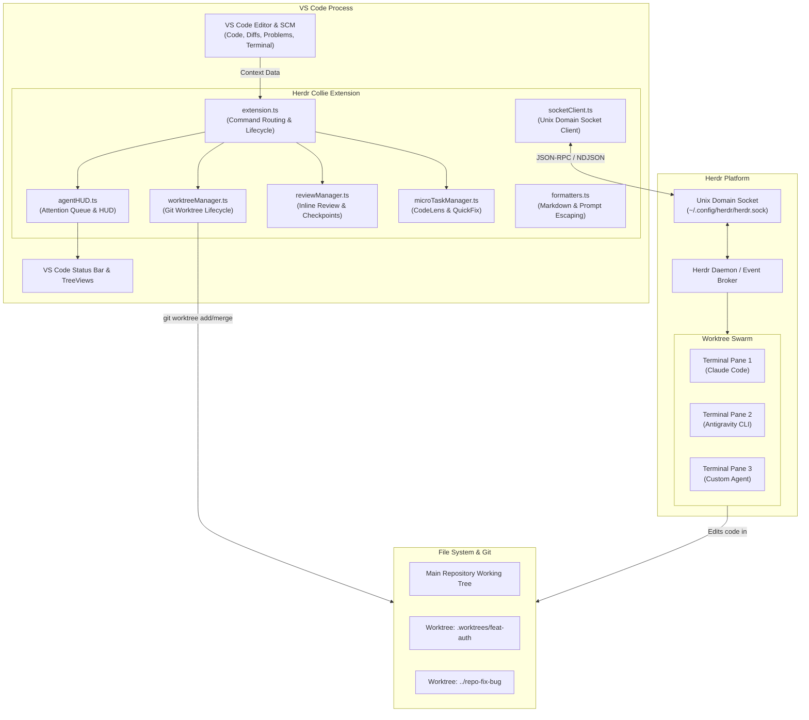
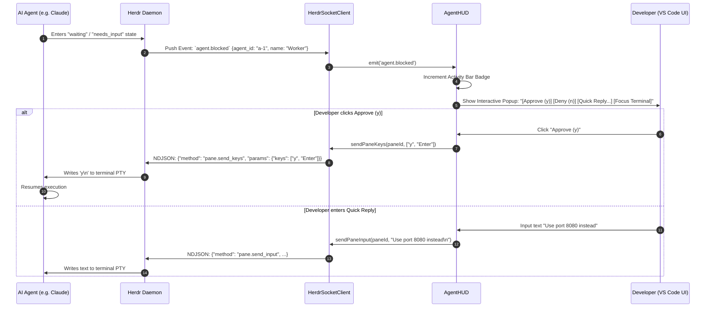
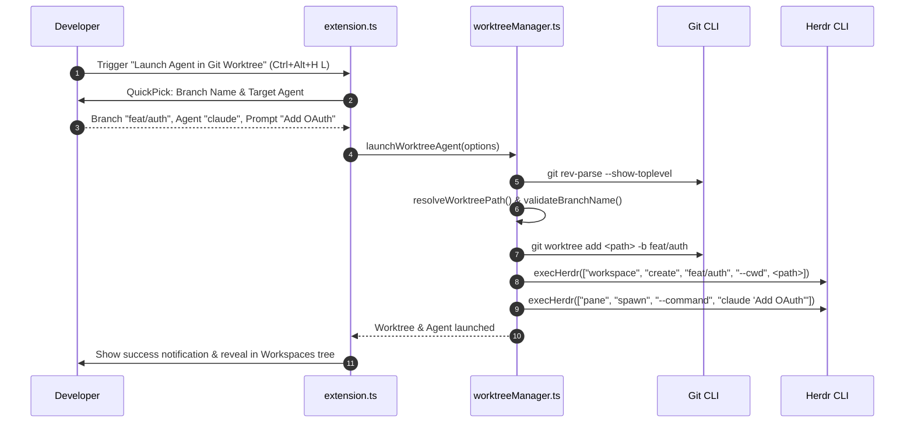

# Herdr Collie — Architecture & System Design

This document details the internal architecture, module responsibilities, IPC communication protocols, and data flows of **Herdr Collie**.

---

## 1. High-Level System Architecture

Herdr Collie acts as an intelligent bridge connecting the **VS Code Extension Host** to the **Herdr CLI & Daemon** and its managed AI agents via Unix domain sockets and Git worktrees.



---

## 2. Core Modules & Responsibilities

| Module | Source File | Responsibilities |
| :--- | :--- | :--- |
| **Extension Entrypoint** | [`src/extension.ts`](file:///src/extension.ts) | Registers all 25+ commands, initializes views, coordinates lifecycle, and wires providers to VS Code. |
| **Socket IPC Client** | [`src/socketClient.ts`](file:///src/socketClient.ts) | Connects to Herdr's Unix domain socket, handles subscriptions (`events.subscribe`), queries snapshots (`session.snapshot`), and dispatches keys/inputs. |
| **Git Worktree Manager** | [`src/worktreeManager.ts`](file:///src/worktreeManager.ts) | Manages worktree provisioning, branch validation/sanitation, prompt quoting (`quoteForShell`), conflict-aware merging, and directory cleanup. |
| **Agent Attention HUD** | [`src/agentHUD.ts`](file:///src/agentHUD.ts) | Real-time status bar HUD, priority-based Attention Queue, unread activity bar counter, and interactive notification approvals. |
| **Workspace HUD** | [`src/workspaceHUD.ts`](file:///src/workspaceHUD.ts) | Dedicated status bar item tracking the focused Herdr workspace with one-click workspace switching. |
| **Integrated Review** | [`src/reviewManager.ts`](file:///src/reviewManager.ts) | Visual review workflow using `vscode.comments`, git checkpoint creation (`createReviewCheckpoint`), rollback, and structured diff-to-prompt dispatch. |
| **Micro-Task Dispatcher** | [`src/microTaskManager.ts`](file:///src/microTaskManager.ts) | Implements `vscode.languages.registerCodeLensProvider` and `registerCodeActionsProvider` (QuickFix) to delegate test fixes, edge-case generation, and TODO items to idle agents. |
| **Context Formatters** | [`src/formatters.ts`](file:///src/formatters.ts) | Formats selections, hover symbols, diagnostics, diffs, and terminal outputs. Implements `formatCodeFence` with dynamic backtick expansion to defend against prompt injection. |
| **Safe CLI Executors** | [`src/executors.ts`](file:///src/executors.ts) | Safely wraps child processes via `execFile` with discrete argument arrays (`execHerdr`, `runGitCmd`), and checks command availability (`which` / `where`). |
| **Config Synchronizer** | [`src/configManager.ts`](file:///src/configManager.ts) | Generates an embedded temporary TOML configuration to auto-hide Herdr's TUI sidebar inside VS Code's integrated terminal. |

---

## 3. Communication Protocols & Data Flows

### A. Socket Protocol (NDJSON over Unix Domain Socket)
Herdr Collie communicates with Herdr's background socket (`~/.config/herdr/herdr.sock` or `~/.config/herdr/sessions/<session>/herdr.sock`) using newline-delimited JSON (NDJSON):

1. **Automatic Subscription**: Upon connecting, Collie subscribes to workspace, tab, pane, and agent lifecycle events:
   ```json
   {"id": "collie_sub", "method": "events.subscribe", "params": {"subscriptions": [{"type": "agent_status"}, ...]}}
   ```
2. **Snapshot Querying**:
   ```json
   {"id": "collie_snap_1", "method": "session.snapshot"}
   ```
3. **Interactive Key / Input Injection**:
   ```json
   {"id": "collie_key_2", "method": "pane.send_keys", "params": {"pane_id": "p-123", "keys": ["y", "Enter"]}}
   ```

### B. Agent Interactive Approval Flow (Sequence Diagram)

When an AI agent requests confirmation (e.g. running a bash command or accessing a file):



### C. Git Worktree Launch Flow (Sequence Diagram)



---

## 4. Security & Safety Model

1. **Option Injection Defense**:
   All user-supplied names (branch names, session names, workspace labels) are validated using strict regexes. Names starting with a hyphen (`-`) are rejected to prevent command option injection into Git or CLI tools.
2. **Command Injection Prevention**:
   Discrete argument arrays are passed to `child_process.execFile`. When building terminal launch command strings, all arguments are escaped via `quoteForShell` and embedded newlines are normalized to spaces to prevent terminal shell breakouts.
3. **Prompt Injection & Fence Breakout Defense**:
   `formatCodeFence(content, lang)` counts consecutive backticks in user code. If code contains ` ``` `, the wrapping fence expands to ` ```` ` or higher, preventing untrusted snippets from breaking out of prompt containers.
4. **Checkpointing & Disaster Recovery**:
   Prior to submitting code reviews, `ReviewManager` captures working tree checkpoints via Git, enabling developers to roll back with zero data loss if an agent creates undesirable changes.
